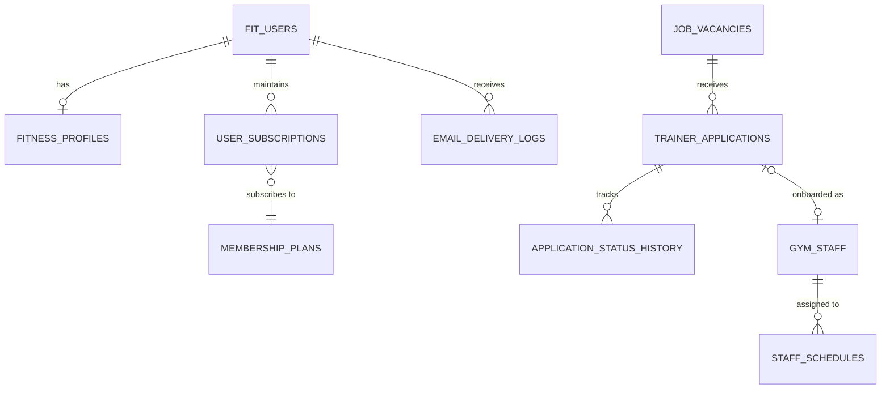

# FitFlow – Gym Management & Fitness Intelligence System

[](https://openjdk.org/)
[](https://spring.io/projects/spring-boot)
[](https://spring.io/projects/spring-security)
[](https://react.dev/)
[](https://tailwindcss.com/)
[](https://www.postgresql.org/)
[](https://vitejs.dev/)

> **FitFlow** is a modern full-stack gym management platform and athletic training system. It bridges member self-service (personalized routines, 3D exercises, and 24/7 AI coaching) with enterprise gym administration (membership subscription lifecycles, collision-free trainer scheduling, recruitment pipelines, and automated email alerts).

---

## 🌐 Live Production Deployments

| Component | Platform | URL |
|---|---|---|
| **Frontend Web App** | Vercel | [https://gym-management-system-sepia-chi.vercel.app/](https://gym-management-system-sepia-chi.vercel.app/) |
| **Backend REST API** | Render | [https://fitflow-backend-qxvp.onrender.com](https://fitflow-backend-qxvp.onrender.com) |
| **Database** | Neon Serverless PostgreSQL | AWS us-east-1 Cloud Instance |

---

## ⚡ Quick Start (Run Locally in 5 Minutes)

### Prerequisites
- **Java:** JDK 21+
- **Node.js:** v18+ or v20+
- **Database:** PostgreSQL 14+ running locally on port `5432`
- **Build Tool:** Apache Maven 3.8+

---

### Step 1: Database Setup
Create a local database named `fitflow`:
```sql
CREATE DATABASE fitflow;
```

---

### Step 2: Start the Backend (Spring Boot)
1. Open a terminal in the `backend/` folder:
   ```bash
   cd backend
   mvn spring-boot:run
   ```
2. The backend starts at `http://localhost:8080`.
3. Schema creation and demonstration seed data run automatically on startup.

---

### Step 3: Start the Frontend (React + Vite)
1. Open a second terminal in the `frontend/` folder:
   ```bash
   cd frontend
   npm install
   npm run dev
   ```
2. Open your browser at `http://localhost:5173`.

---

## 🔑 Default Demonstration Accounts

| Role | Email | Password | Access Rights |
|---|---|---|---|
| **System Administrator** | `admin@fitflow.com` | `admin123` | Full access to `/admin` dashboard, payroll, shift scheduling, candidate hiring, and email controls. |
| **Personal Trainer** | `trainer@fitflow.com` | `trainer123` | Access to trainer schedules and client workout routines. |
| **Gym Member** | `member@fitflow.com` | `member123` | Member self-service: personal workout plans, habit tracker, and membership overview. |

---

## 🚀 Key Features

### 1. 📱 Mobile-First Responsive Experience
- **Touch-Friendly Navigation Drawer:** Slide-out mobile menu with 48px tap targets, custom icons, dark backdrop dismissal, and keyboard `Escape` closing.
- **Responsive Hero Section:** Dynamic headline typography, high-contrast dark overlay, and automatic background crossfade.
- **Program Carousel:** Smooth horizontal swipe gestures on mobile with left/right carousel buttons on desktop.
- **Scroll Lock:** Automatically locks background body scroll whenever menus or modals are open.

### 2. 🏋️ Member Experience Portal
- **Interactive Onboarding:** 10-step preference setup calculating Body Mass Index (BMI) and daily caloric targets.
- **Exercise Library:** 3D muscle biomechanics diagrams and step-by-step form execution cues.
- **Custom Workout Tracker:** Log sets, reps, weight, and hydration with PostgreSQL persistence.
- **Subscription Transparency:** Real-time remaining day countdowns and renewal options.

### 3. 🤖 Aura AI Coach (24/7 Intelligent Guidance)
- **Interactive Coaching Dialog:** Dedicated modal assistant for instant workout splits, nutrition tips, and recovery advice.
- **1-Click Quick Prompts:** Pre-configured athletic queries (*"Chest exercises?"*, *"Hydration goals?"*, *"Beginner routine?"*).

### 4. 🛡️ Admin Command Console (`/admin`)
- **Real-Time KPIs:** Live metric cards for total members, active subscriptions, expiring plans, and email deliveries.
- **Shift Scheduling with Collision Detection:** Algorithmic check in `StaffService.java` that rejects overlapping working hours for the same trainer.
- **Trainer Directory & Confidential Payroll:** Protected by Spring Security (`ROLE_ADMIN`), ensuring salaries are never exposed to public APIs.

### 5. 💼 Public Careers & Recruitment Pipeline (`/careers/trainers`)
- **Public Job Board:** Prospective coaches can view open vacancies without logging in.
- **Candidate Application Form:** Multi-part application with resume upload (PDF/DOCX) and unique reference generation (`APP-YYYY-XXXX`).
- **1-Click Staff Onboarding:** Administrators can review candidate statuses (`SUBMITTED → INTERVIEW → SELECTED`) and convert hired coaches directly into active staff records.

### 6. 📧 Automated Email Notification Engine
- **Welcome Email on Registration:** Immediately dispatched upon sign-up with dark/red branded HTML formatting.
- **2-Day Expiry Reminder:** Automated daily cron scheduler at `08:05 AM` alerting members whose subscription expires in 2 days.
- **Expired Membership Notice:** Automated daily cron scheduler at `08:10 AM` alerting lapsed members.
- **Idempotency Guarantee:** Enforced via PostgreSQL unique constraints (`uq_email_log_user_type_date`) to prevent duplicate emails on restarts.
- **Admin Management Panel:** Interactive interface with individual sends, multi-user select bulk actions, and 1-click retry on failed deliveries.

---

## 🏗️ System Architecture

```text
[ CLIENT TIER ]
   │  React.js Single-Page Application (Tailwind CSS, Lucide Icons, Vite)
   │  Axios HTTP Client with Authorization: Bearer <JWT> Interceptor
   ▼
[ SECURITY & FILTER TIER ]
   │  SecurityFilterChain (CORS Configured, Stateless Session)
   │  JwtAuthenticationFilter (Validates Token Signature & Claims)
   ▼
[ CONTROLLER LAYER ]
   │  @RestController (Auth, Members, Staff, Recruitment, Email, Metrics)
   │  DTO Validation (@Valid, Custom DTO Mappings)
   ▼
[ SERVICE & BUSINESS LOGIC LAYER ]
   │  @Service (StaffService, RecruitmentService, EmailService, AuthService)
   │  Business Rules: Shift collision validation, vacancy quotas, idempotency
   ▼
[ PERSISTENCE & DATABASE TIER ]
   │  Spring Data JPA / Hibernate 6.6
   ▼  PostgreSQL 17 Relational Database (Relational Foreign Keys, Constraints)
```

---

## 🗄️ Database Design (Entity-Relationship Diagram)



---

## 📡 REST API Reference Summary

### Public Endpoints (No Token Required)
| Method | Endpoint | Description |
|---|---|---|
| `POST` | `/api/auth/register` | Register a new member account & trigger welcome email |
| `POST` | `/api/auth/login` | Authenticate credentials and receive signed JWT |
| `GET` | `/api/careers/vacancies` | List currently open trainer vacancies |
| `POST` | `/api/careers/vacancies/{id}/applications` | Submit coaching application with resume |

### Member Endpoints (`ROLE_MEMBER` or `ROLE_ADMIN`)
| Method | Endpoint | Description |
|---|---|---|
| `GET` | `/api/users/profile` | Retrieve personal fitness metrics & BMI |
| `GET` | `/api/exercises` | Browse 3D exercise catalog |
| `GET` | `/api/workouts/routines` | Get saved daily workout routines |

### Admin Endpoints (`ROLE_ADMIN` Only)
| Method | Endpoint | Description |
|---|---|---|
| `GET` | `/api/admin/dashboard/metrics` | Retrieve platform KPI metric overview |
| `GET` | `/api/admin/members` | Member directory with remaining day countdowns |
| `GET` | `/api/admin/staff` | Staff directory with confidential payroll |
| `POST` | `/api/admin/staff-schedules` | Assign shift with server-side collision check |
| `POST` | `/api/admin/applications/{id}/convert-to-staff` | 1-click candidate conversion to official staff |
| `GET` | `/api/admin/email/memberships` | Email notification management & KPI overview |
| `POST` | `/api/admin/email/send-reminder-2day/{userId}` | Trigger 2-day expiry reminder to specific user |
| `POST` | `/api/admin/email/send-expired-notice/{userId}`| Trigger expired notification to specific user |
| `POST` | `/api/admin/email/send-bulk` | Bulk dispatch reminders to selected users |
| `POST` | `/api/admin/email/retry/{logId}` | Retry failed email notification delivery |

---

## ⚙️ Environment Variables Reference

When deploying to cloud hosts such as **Render** or **Vercel**, configure these variables:

| Environment Variable | Description | Example / Default |
|---|---|---|
| `SPRING_DATASOURCE_URL` | JDBC database connection URL | `jdbc:postgresql://<HOST>:5432/fitflow` |
| `DB_USERNAME` | PostgreSQL database user | `postgres` |
| `DB_PASSWORD` | PostgreSQL database password | `<YOUR_DATABASE_PASSWORD>` |
| `JWT_SECRET` | 256-bit cryptographic signing key | `<YOUR_SECURE_JWT_SECRET>` |
| `MAIL_HOST` | SMTP server host | `smtp.gmail.com` |
| `MAIL_PORT` | SMTP port | `587` |
| `MAIL_USERNAME` | Sender email address | `your_email@gmail.com` |
| `MAIL_PASSWORD` | Google App Password (16 characters) | `<YOUR_GOOGLE_APP_PASSWORD>` |
| `SMTP_ENABLED` | Set to `true` for live sending, `false` for mock logging | `true` |
| `FRONTEND_URL` | Deployed frontend domain for CORS | `https://gym-management-system-sepia-chi.vercel.app` |

---

## 🎓 Academic Defense & Viva Q&A Guide

#### Q1: How does the system prevent two trainers from being scheduled at the same time?
> **Answer:** *"In `StaffService.java`, the `createSchedule()` method inspects existing shifts for the target staff member across the requested days. If the new start and end times intersect with an active shift, it throws an `IllegalArgumentException`, resulting in an HTTP 400 Bad Request with an alert message."*

#### Q2: How is candidate-to-staff conversion handled safely?
> **Answer:** *"When an administrator clicks 'Convert to Staff', the backend validates that `convertedToStaff` is false. Inside a single `@Transactional` boundary, it creates a new `GymStaff` record, flags the application as converted, records an audit log transition to `SELECTED`, and increments the vacancy's filled position counter."*

#### Q3: How do you prevent duplicate emails when the application restarts?
> **Answer:** *"Every email delivery is logged in the `email_delivery_logs` table. A database-level unique constraint on `(user_id, notification_type, scheduled_date)` prevents duplicate records from ever being created or dispatched on the same day."*

#### Q4: Why are regular members and trainers stored in separate tables?
> **Answer:** *"Gym members have subscription periods, workout logs, and biometric statistics, whereas trainers have employment contracts, shifts, certifications, and confidential monthly salaries. Storing them in separate tables (`fit_users` vs `gym_staff`) enforces clean domain boundaries and prevents accidental exposure of payroll data."*

---

## 📝 License & Authorship

- **Project:** FitFlow – Gym Management & Recruitment Intelligence System
- **Candidate:** Java Full Stack Developer Intern
- **Institution:** CMR University, Bengaluru
- **Industry Partner:** Excerpt Technologies
- **Faculty Guide:** Dr. Deepa A.
