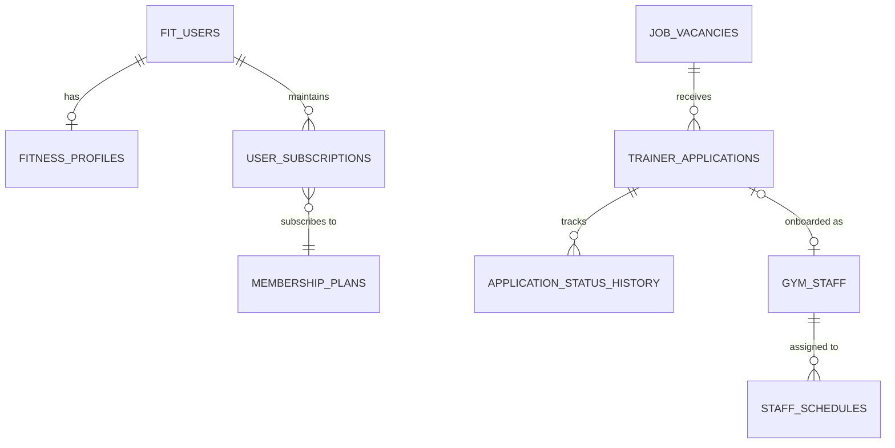

# FitFlow – Gym Management & Recruitment Intelligence System

[](https://openjdk.org/)
[](https://spring.io/projects/spring-boot)
[](https://spring.io/projects/spring-security)
[](https://react.dev/)
[](https://tailwindcss.com/)
[](https://www.postgresql.org/)
[](https://hibernate.org/)

---

## Academic Review Metadata

- **Project Title:** FitFlow – Gym Management & Recruitment Intelligence System
- **Candidate:** Java Full Stack Developer Intern
- **Internship Organization:** Excerpt Technologies
- **Internship Role:** Java Full Stack Developer Intern
- **University:** CMR University, Bengaluru
- **Faculty Guide:** Dr. Deepa A.
- **Internship Period:** 19 August 2026 to 19 October 2026
- **Project Domain:** Enterprise Health & Fitness Resource Planning (ERP)
- **Application Status:** Working, fully functional full-stack application verified with live PostgreSQL persistence.

---

## 1. Project Introduction & Ready-to-Speak Pitches

### 30-Second Elevator Pitch
> *"Respected guide Dr. Deepa ma’am and honorable panel members, I present **FitFlow**, a cloud-ready Gym Management and Fitness Intelligence System developed during my internship at Excerpt Technologies. Built using **React.js, Spring Boot, Spring Security, and PostgreSQL**, FitFlow bridges the gap between everyday workout tracking for members and mission-critical gym operations—such as subscription lifecycles, trainer shift scheduling with collision detection, and coach recruitment—all protected by role-based JWT authentication."*

### 1-Minute Project Overview
> *"Traditional fitness centers face serious operational challenges: paper logs, missed subscription renewals, manual shift scheduling conflicts, and disorganized hiring channels for personal trainers. FitFlow solves this with a decoupled 3-tier architecture. On the frontend, a responsive React and Tailwind single-page application delivers a dark gym aesthetic. On the backend, Spring Boot 3.4 and Hibernate ORM enforce strict business validation and security over a PostgreSQL 17 relational database. The system features a Member Self-Service portal, an Admin Command Console with a 9-section sidebar, and a public career portal at `/careers/trainers` for talent recruitment."*

### 2-Minute Complete Defense Script
> *"Good morning, respected guide Dr. Deepa ma’am and panel members.
>
> **The Problem:** Modern fitness centers manage hundreds of active members and dozens of trainers. Relying on disconnected spreadsheets causes revenue leakage from expired subscriptions, scheduling clashes between trainers, and loss of qualified coaching candidates.
>
> **Our Solution:** FitFlow is a unified Java Full Stack ERP platform:
> 1. **Client Tier:** React.js single-page application with Tailwind CSS, Axios interceptors, and client-side routing.
> 2. **Security Tier:** Stateless Spring Security 6 with JSON Web Tokens (JWT) and Role-Based Access Control (`ROLE_MEMBER`, `ROLE_ADMIN`, `ROLE_TRAINER`), securing confidential trainer salaries and candidate resumes.
> 3. **Persistence Tier:** Java 21, Spring Data JPA, and PostgreSQL 17, guaranteeing ACID compliance.
>
> **Core Deliverables:**
> - **Member Portal:** Fitness onboarding, BMI and caloric calculations, exercise database with 3D models, and subscription validity countdowns.
> - **Admin Console:** Live KPI metrics, isolated member directory (separate from staff), shift rotas with server-side time conflict detection, and email deadline notifications.
> - **Recruitment Pipeline:** Public careers portal (`/careers/trainers`) allowing prospective coaches to apply with resumes, which administrators review through a full status workflow (`SUBMITTED → INTERVIEW → SELECTED`) and convert into official staff records with one click.
>
> All backend endpoints, entity relationships, and frontend views are verified and functional against live PostgreSQL data."*

---

## 2. Problem Statement & Proposed Solution

| Operational Bottleneck in Traditional Gyms | How FitFlow Solves It |
|---|---|
| **Manual Member Registers:** Paper or Excel sheets cause data loss and lack audit trails. | Normalized PostgreSQL relational database with encrypted accounts and automated history tracking. |
| **Subscription Revenue Leakage:** Gyms miss upcoming member expirations, delaying renewals. | Dynamic expiry calculation displaying remaining days (`remainingDays`) and 1-click email/SMS reminders. |
| **Trainer Scheduling Collisions:** Double-booked personal training sessions damage customer satisfaction. | Algorithmic shift conflict check in the service layer preventing overlapping working hours for the same trainer. |
| **Scattered Recruitment:** Coach resumes get lost in inboxes without evaluation stages. | Dedicated public careers portal (`/careers/trainers`) and admin candidate tracking pipeline with one-click staff conversion. |

---

## 3. System Architecture & Request Lifecycle

FitFlow is built on a **Decoupled 3-Tier Client-Server Architecture**:

```text
[ CLIENT TIER ]
   │  React.js Single-Page Application (Tailwind CSS, Component Architecture)
   │  Axios HTTP Client with Authorization: Bearer <JWT> Interceptor
   ▼
[ NETWORK / HTTP TIER ]
   │  RESTful Endpoints: /api/auth/**, /api/admin/**, /api/careers/**
   │  JSON Request / Response Payloads
   ▼
[ SECURITY & FILTER TIER ]
   │  SecurityFilterChain (CORS Configured, CSRF Disabled for Stateless APIs)
   │  JwtAuthenticationFilter (Token Signature Verification & Claims Extraction)
   │  SecurityContextHolder (Populated with User Principal & Roles)
   ▼
[ CONTROLLER LAYER ]
   │  @RestController (AdminStaffController, PublicCareersController, etc.)
   │  Input Validation (@Valid, DTO Mapping)
   ▼
[ SERVICE LAYER ]
   │  @Service (StaffService, RecruitmentService, AuthService, EmailService)
   │  Business Rules: Shift collision validation, vacancy quota computation
   │  @Transactional Execution Boundaries
   ▼
[ PERSISTENCE LAYER ]
   │  Spring Data JPA Repositories (GymStaffRepository, JobVacancyRepository)
   │  Hibernate ORM (HQL / SQL Generation, Entity Lifecycle Management)
   ▼
[ DATABASE TIER ]
      PostgreSQL 17 Database (fitflow schema, Relational Constraints, WAL)
```

### End-to-End Request Journey:
1. **Client Action:** The Administrator clicks **"Assign Shift"** in the Staff Schedules view.
2. **HTTP Dispatch:** React dispatches a `POST /api/admin/staff-schedules` request with an `Authorization: Bearer <token>` header.
3. **Filter Chain:** `JwtAuthenticationFilter` validates token signature and expiry, then authenticates the user as `ROLE_ADMIN`.
4. **Controller Routing:** `AdminStaffController` receives the request and validates the DTO.
5. **Business Logic:** `StaffService` runs `hasShiftOverlap()` to check if the staff member already has a shift on the specified day and time.
6. **Data Persistence:** If valid, `StaffScheduleRepository.save()` executes SQL `INSERT INTO staff_schedules...`.
7. **Client Update:** A `StaffScheduleDto` is returned with HTTP 201 Created, immediately updating the weekly rota without a page reload.

---

## 4. Key Modules & Functional Overview

### 4.1. Admin Dashboard (9-Section Navigation)
1. **Overview:** Live platform analytics, member/subscription stats, recruitment status, and quick-action shortcuts.
2. **Members:** Dedicated gym member directory with remaining subscription days countdown (`remainingDays`) and renewal alert actions.
3. **Trainers & Training Staff:** Top 6 summary cards, searchable staff directory, profile inspector, add/edit trainer modal with confidential salary controls, assigned shifts, and resignation recording.
4. **Recruitment & Vacancies:** 7 recruitment KPI cards, vacancy publishing/editing, dynamic deadlines, opening dates, and remaining position quotas.
5. **Trainer Applications:** 8 pipeline stage cards, applicant search/filtering, full candidate detail drawer, resume download, status audit trail, interview scheduling, reviewer notes, and one-click **"Convert to Staff"**.
6. **Staff Schedules:** Weekly rota grid & detailed shift table, shift assignment modal with server-side time conflict detection, and rest days tracking.
7. **Subscriptions:** Live member subscription entitlements, renewal tracking, auto-renew, and premium active indicators.
8. **Notifications:** Configured Gmail recipient list (`appu12813@gmail.com`), SMTP status, direct SMS gateway status, upcoming deadline alerts, and live email audit log.
9. **Settings:** Admin console identity, JWT security details, recruitment paths, and raw PostgreSQL DB explorer access.

### 4.2. Member Experience Portal
- **Onboarding & Profile Setup:** 10-step preference setup calculating BMI and target daily calorie intake.
- **3D Exercise Visualizer:** Interactive exercise catalog categorized by muscle groups.
- **Custom Workout Routines:** Daily workout tracking, rest intervals, and recovery monitoring.
- **Subscription Transparency:** Members can inspect plan start/end dates, active status, and renewing options.

### 4.3. Public Careers & Hiring Portal (`/careers/trainers`)
- Accessible to anyone without logging in.
- Shows only currently open job postings with title, specialization, qualifications, experience, location, and salary ranges.
- Allows candidates to apply with resume uploads (PDF/DOCX), privacy consent, and validation.
- Auto-generates unique reference numbers (`APP-YYYY-XXXX`) and prevents duplicate submissions.

---

## 5. Technology Stack Deep Dive

| Layer | Technology | Version | Purpose in FitFlow |
|---|---|---|---|
| **Frontend Framework** | React.js | 18 / 19 | Declarative Single Page Application (SPA) architecture |
| **Build Tool** | Vite | 8.x | High-performance client bundling and Hot Module Replacement |
| **Styling** | Tailwind CSS | 3.x | Utility-first styling for FitFlow's dark gym aesthetic |
| **Icons & UI** | Lucide React | Latest | Modern iconography across dashboard and careers portal |
| **Backend Language** | Java | 21 LTS | Statically typed, object-oriented enterprise application layer |
| **Backend Framework** | Spring Boot | 3.4.x | Convention-over-configuration REST APIs and dependency injection |
| **Security** | Spring Security | 6.x | Security filter chains, role-based access control (RBAC), CORS |
| **Authentication** | jjwt (JSON Web Token) | 0.11.x | Stateless cryptographic bearer authentication |
| **Persistence / ORM** | Spring Data JPA / Hibernate | 6.6 | Object-Relational Mapping and repository abstractions |
| **Database** | PostgreSQL | 17 | Relational ACID-compliant data storage |
| **Database Tooling** | pgAdmin 4 | Latest | Database administration, table inspection, and SQL queries |
| **Build System** | Apache Maven | 3.8+ | Dependency management, build lifecycle, and packaging |

---

## 6. PostgreSQL Database Design

### 6.1. Relational Entities Summary



### 6.2. Core Tables Schema

#### `fit_users` (Core User Accounts)
- `id` (BIGSERIAL, PK)
- `name` (VARCHAR)
- `email` (VARCHAR, UNIQUE)
- `password` (VARCHAR, BCrypt Encrypted)
- `phone` (VARCHAR)
- `role` (VARCHAR: `MEMBER`, `ADMIN`, `TRAINER`)
- `enabled` (BOOLEAN)
- `registered_at` (TIMESTAMP)

#### `gym_staff` (Trainers & Staff Directory)
- `id` (BIGSERIAL, PK)
- `staff_code` (VARCHAR, UNIQUE: e.g. `STF-1001`)
- `full_name` (VARCHAR)
- `email` (VARCHAR, UNIQUE)
- `phone` (VARCHAR)
- `designation` (VARCHAR)
- `specialization` (VARCHAR)
- `years_of_experience` (NUMERIC)
- `qualifications` (TEXT)
- `monthly_salary` (NUMERIC, Confidential Admin Access Only)
- `employment_type` (VARCHAR: `FULL_TIME`, `PART_TIME`, `CONTRACT`)
- `status` (VARCHAR: `ACTIVE`, `INACTIVE`, `ON_LEAVE`, `RESIGNED`, `TERMINATED`)
- `assigned_shift` (VARCHAR)
- `joining_date` (DATE)
- `resignation_date` (DATE)

#### `job_vacancies` (Hiring Postings)
- `id` (BIGSERIAL, PK)
- `title` (VARCHAR)
- `department` (VARCHAR)
- `specialization` (VARCHAR)
- `total_vacancies` (INT)
- `filled_count` (INT)
- `job_description` (TEXT)
- `required_qualifications` (TEXT)
- `minimum_experience_years` (NUMERIC)
- `preferred_experience_years` (NUMERIC)
- `employment_type` (VARCHAR)
- `salary_range` (VARCHAR)
- `location` (VARCHAR)
- `opening_date` (DATE)
- `application_deadline` (DATE)
- `status` (VARCHAR: `DRAFT`, `SCHEDULED`, `OPEN`, `CLOSED`, `CANCELLED`)

#### `trainer_applications` (Candidate Pipeline)
- `id` (BIGSERIAL, PK)
- `application_reference` (VARCHAR, UNIQUE: e.g. `APP-2026-6132`)
- `vacancy_id` (BIGINT, FK -> `job_vacancies.id`)
- `full_name` (VARCHAR)
- `email` (VARCHAR)
- `phone` (VARCHAR)
- `current_location` (VARCHAR)
- `desired_position` (VARCHAR)
- `years_of_experience` (NUMERIC)
- `specialization` (VARCHAR)
- `educational_qualifications` (TEXT)
- `fitness_certifications` (TEXT)
- `previous_experience` (TEXT)
- `professional_summary` (TEXT)
- `expected_joining_date` (DATE)
- `resume_path` (VARCHAR)
- `status` (VARCHAR: `SUBMITTED`, `UNDER_REVIEW`, `SHORTLISTED`, `INTERVIEW_SCHEDULED`, `SELECTED`, `REJECTED`, `WITHDRAWN`)
- `converted_to_staff` (BOOLEAN)
- `converted_staff_id` (BIGINT, FK -> `gym_staff.id`)
- `CONSTRAINT uq_app_vacancy_email UNIQUE (vacancy_id, email)`

#### `staff_schedules` (Shift Assignments)
- `id` (BIGSERIAL, PK)
- `staff_id` (BIGINT, FK -> `gym_staff.id`)
- `shift_name` (VARCHAR)
- `start_time` (TIME)
- `end_time` (TIME)
- `working_days` (VARCHAR)
- `schedule_date` (DATE)
- `rest_days` (VARCHAR)
- `status` (VARCHAR: `SCHEDULED`, `COMPLETED`, `CANCELLED`)

---

## 7. REST API Endpoints Reference

### Public Endpoints (No Authentication Required)
| Method | Endpoint | Description |
|---|---|---|
| `POST` | `/api/auth/register` | Register a new gym member account |
| `POST` | `/api/auth/login` | Authenticate user and return signed JWT |
| `GET` | `/api/careers/vacancies` | List all open, published job vacancies |
| `GET` | `/api/careers/vacancies/{id}` | Detailed requirements for a vacancy |
| `POST` | `/api/careers/vacancies/{id}/applications` | Submit application (multipart with resume or JSON) |

### Member Endpoints (`hasAnyRole('MEMBER', 'ADMIN')`)
| Method | Endpoint | Description |
|---|---|---|
| `GET` | `/api/users/profile` | Get current member profile & metrics |
| `PUT` | `/api/users/profile` | Update physical stats (weight, goal) |
| `GET` | `/api/exercises` | Browse exercise catalog |
| `GET` | `/api/workouts/routines` | Get saved member workout routines |

### Admin Endpoints (`hasRole('ADMIN')`)
| Method | Endpoint | Description |
|---|---|---|
| `GET` | `/api/admin/dashboard/metrics` | Platform overview KPIs |
| `GET` | `/api/admin/members` | Isolated member directory with remaining days |
| `POST` | `/api/admin/users/{id}/toggle-status` | Activate/Deactivate user account |
| `GET` | `/api/admin/staff` | Searchable staff directory with confidential payroll |
| `POST` | `/api/admin/staff` | Add new trainer/staff member |
| `PUT` | `/api/admin/staff/{id}` | Update trainer details |
| `PATCH`| `/api/admin/staff/{id}/status` | Update employment status or record resignation |
| `GET` | `/api/admin/vacancies` | List all vacancies (all statuses) |
| `POST` | `/api/admin/vacancies` | Publish new vacancy |
| `PATCH`| `/api/admin/vacancies/{id}/status` | Open, close, reopen, or cancel vacancy |
| `GET` | `/api/admin/applications` | Candidate applications with filters |
| `GET` | `/api/admin/applications/{id}/resume` | Download candidate resume document |
| `PATCH`| `/api/admin/applications/{id}/status` | Transition status with audit log |
| `POST` | `/api/admin/applications/{id}/interviews` | Schedule interview date/time/link |
| `POST` | `/api/admin/applications/{id}/notes` | Append internal reviewer feedback note |
| `POST` | `/api/admin/applications/{id}/convert-to-staff` | Onboard selected candidate to `gym_staff` |
| `GET` | `/api/admin/staff-schedules` | Get weekly shift assignments |
| `POST` | `/api/admin/staff-schedules` | Assign shift with collision detection |
| `POST` | `/api/admin/subscriptions/reminders/send` | Broadcast deadline alerts to recipients |

---

## 8. Installation & Setup Guide

### 8.1. Prerequisites
- **Java:** JDK 21+ installed and configured in `PATH`.
- **Node.js:** v18+ or v20+.
- **Database:** PostgreSQL 14+ running on port `5432`.
- **Build Tool:** Apache Maven 3.8+.

### 8.2. Database Configuration
1. Open PostgreSQL terminal or pgAdmin 4:
   ```sql
   CREATE DATABASE fitflow;
   ```
2. Verify credentials in `backend/src/main/resources/application.properties`:
   ```properties
   spring.datasource.url=jdbc:postgresql://localhost:5432/fitflow
   spring.datasource.username=postgres
   spring.datasource.password=Appu@1234
   ```

### 8.3. Running the Backend
1. Open a terminal in the `backend/` directory:
   ```cmd
   cd backend
   mvn clean compile
   mvn spring-boot:run
   ```
2. Backend starts on port `8080`.
3. The database migration script `schema_staff_recruitment.sql` and `DataSeeder.java` run automatically on startup to seed test data.

### 8.4. Running the Frontend
1. Open a second terminal in the `frontend/` directory:
   ```cmd
   cd frontend
   npm install
   npm run dev
   ```
2. Open your browser at `http://localhost:5173`.
3. To test production builds:
   ```cmd
   cmd /c "npm run build"
   ```

---

## 9. Default Test Accounts

| Role | Email ID | Password | Access Level |
|---|---|---|---|
| **System Administrator** | `appu12813@gmail.com` | `Lulu@3002` | Full access to `/admin` dashboard, confidential payroll, candidate reviews, and shift scheduling. |
| **Personal Trainer** | `trainer@fitflow.com` | `trainer123` | Trainer access to assigned routines and appointments. |
| **Gym Member** | `member@fitflow.com` | `member123` | Member portal access: routines, profile, and subscription view. |

---

## 10. University Final Review & Viva Preparation

### 10.1. Common Viva Questions & Model Answers

#### Q: How do you prevent two trainers from being scheduled at the same time?
- **Answer:** *"In `StaffService.java`, the `createSchedule()` method queries existing shifts for the specified staff member. It checks if the new start and end times overlap with an existing shift on any of the specified working days. If an overlap is found, it throws an `IllegalArgumentException`, which returns an HTTP 400 Bad Request to the frontend with an alert message."*

#### Q: Why are Members kept separate from Trainers in the Admin Dashboard?
- **Answer:** *"A common issue in gym software is treating all users as one generic entity. In FitFlow, ordinary gym members are stored in `fit_users` with `Role.MEMBER` and tracked for subscription expiry and fitness metrics. Trainers and staff are stored in a dedicated `gym_staff` table containing professional designations, certifications, confidential monthly salaries, and shift rotas. The `GET /api/admin/members` endpoint filters exclusively for `Role.MEMBER` to prevent any data overlap."*

#### Q: How does the candidate application workflow maintain an audit trail?
- **Answer:** *"Every time an application transitions status (e.g., from `SUBMITTED` to `UNDER_REVIEW`, `SHORTLISTED`, or `SELECTED`), an `ApplicationStatusHistory` record is created in PostgreSQL with the previous status, new status, the admin's email, and the timestamp. This provides a complete hiring audit trail."*

#### Q: How is candidate-to-staff conversion handled safely?
- **Answer:** *"When an admin clicks 'Convert to Staff', the backend checks that `convertedToStaff` is false to prevent duplicate records. Within a single transaction, it creates a new `GymStaff` record, sets the application's `convertedToStaff` flag to true, links the staff ID, updates the status to `SELECTED`, and increments the vacancy's `filledCount`."*

### 10.2. 5-Minute Live Demonstration Checklist
1. Open `/careers/trainers` -> Show open vacancies and highlight that staff salaries remain hidden from the public.
2. Click **"Apply Now"** -> Fill out the application form with resume upload and submit. Show the generated reference number (`APP-YYYY-XXXX`).
3. Try re-submitting with the same email -> Show the duplicate application rejection message.
4. Log in as Admin at `/admin/login` using `appu12813@gmail.com` / `Lulu@3002`.
5. Open **Members** -> Show member records with remaining subscription day countdowns.
6. Open **Staff Schedules** -> Show the weekly rota view and demonstrate shift conflict validation.
7. Open **Trainer Applications** -> Inspect the application submitted in Step 2, update its status, and demonstrate the **"Convert to Staff"** workflow.

---

## 11. Git & Version Control Conventions

```bash
# Clone the repository
git clone https://github.com/Darshan-yadav-45/Gym-Management-System.git
cd Gym-Management-System

# Check status and recent commits
git status
git log --oneline -n 10
```

---

## 12. License & Academic Declaration

This project was developed for the **Master of Computer Applications (MCA)** final review at **CMR University, Bengaluru**, under the guidance of **Dr. Deepa A.** during an internship at **Excerpt Technologies**. All rights reserved © 2026.
